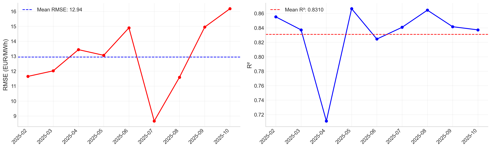
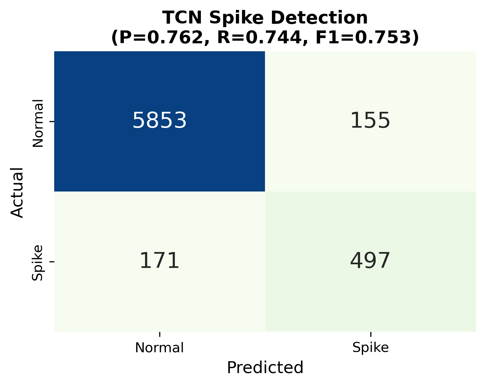
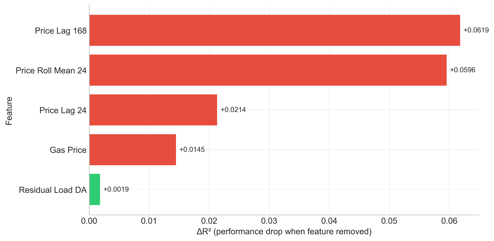
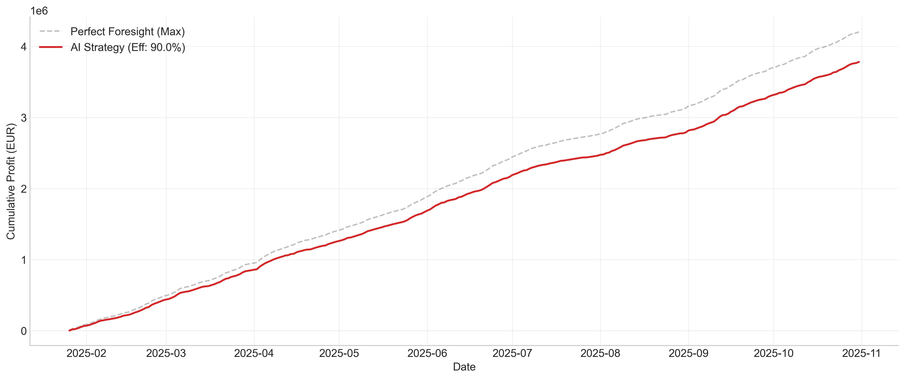
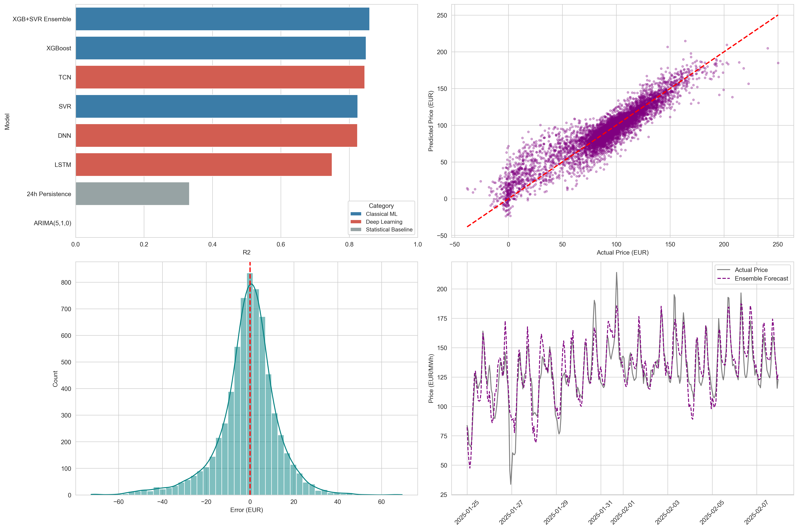

# Modelling the weather-to-renewables-to-price chain pays for itself

A two-stage GB day-ahead electricity price forecaster: walk-forward XGBoost
renewable-generation forecasts built from capacity-weighted regional weather,
feeding an XGB+SVR ensemble benchmarked against TCN, PatchTST, LSTM and BiLSTM.

**Ensemble R² = 0.860, RMSE 13.46 EUR/MWh** over 6,676 held-out hours, against
ARIMA(5,1,0) at 72.94 — and the accuracy converts to money: a 100 MW / 200 MWh
battery dispatched on the forecast captures **89.9% of perfect-foresight
arbitrage profit** under a PuLP linear program.

The evaluation goes past a single split. Rolling-origin validation, Wilcoxon
signed-rank with Bonferroni correction, SHAP attribution, and both conditional
and grouped ablation studies — the last of which produced the most useful
finding: the Stage-1 renewable predictions are largely redundant with the BMRS
day-ahead forecasts **except on spike hours**, which is precisely where the money
is.

Eight-person group coursework project (BENV0148, UCL). My contribution was the
evaluation layer: rolling-origin validation, the conditional and grouped
ablations, and the battery arbitrage LP.


## Status

This is an eight-person group coursework project (BENV0148 Advanced Machine
Learning, UCL Bartlett). This tree has been prepared for public release &mdash;
coursework reports, other students' candidate codes, per-member contribution
statements and commercially licensed source data have all been removed &mdash;
but it is **not published yet**, pending consent from the other seven authors.
The commit history here starts fresh; it is not the group's working history.

**My own contribution** to the group project was the evaluation layer: the
model comparison and statistical testing framework, the rolling-origin
validation, the conditional and grouped ablation studies, and the battery
arbitrage LP. The Stage-0 data collection, the regional weather weighting, the
Stage-1 generation models and the deep-learning architectures were other
members' work. The results below are group results, reported as the pipeline
produces them; the parts I am accountable for are the evaluation numbers.

---

## Results

Chronological 80/20 split: train 26,700 hours (7 January 2022 to 25 January
2025), test 6,676 hours (25 January to 31 October 2025). 33,376 hourly records,
22 features, all audited to be available at t&minus;24h.

| Model | Tier | R&sup2; | RMSE (EUR/MWh) | MAE (EUR/MWh) |
|---|---|---:|---:|---:|
| **XGB+SVR ensemble** | Classical ML | **0.860** | **13.46** | **9.44** |
| XGBoost | Classical ML | 0.849 | 13.97 | 9.63 |
| TCN | Deep learning | 0.845 | 14.15 | 10.21 |
| SVR | Classical ML | 0.825 | 15.05 | 10.75 |
| DNN | Deep learning | 0.824 | 15.07 | 10.78 |
| MLP | Classical ML | 0.822 | 15.19 | 11.19 |
| Random forest | Classical ML | 0.815 | 15.48 | 10.87 |
| BiLSTM | Deep learning | 0.771 | 17.20 | 12.52 |
| LSTM | Deep learning | 0.750 | 17.99 | 12.91 |
| Ridge | Classical ML | 0.744 | 18.20 | 14.16 |
| Decision tree | Classical ML | 0.720 | 19.02 | 13.19 |
| PatchTST | Deep learning | 0.633 | 21.79 | 16.67 |
| 24h persistence | Statistical | 0.333 | 29.37 | 18.91 |
| ARIMA(5,1,0) | Statistical | &minus;3.116 | 72.94 | 64.31 |

Source: `notebooks/03_price_prediction_main_executed.ipynb`.

Three qualifications worth stating up front.

**The ensemble's edge over XGBoost alone is small, and the two significance
tests in this tree disagree about it.** Both test paired *squared* errors with a
Wilcoxon signed-rank test, but they are not the same test on the same fit:

- The canonical Stage-2 run tests one-sided (H1: ensemble error &lt; XGBoost
  error), uncorrected, and reports W = 10,722,888, p = 0.0038
  (`notebooks/03_price_prediction_main_executed.ipynb`, section 4.6a).
- The supplementary analysis refits the ensemble from scratch, tests two-sided
  and Bonferroni-corrects across six pairs, and reports p = 1.0
  (`data/wilcoxon_pairwise.csv`). That refit's ensemble reaches R&sup2; = 0.8561,
  not the canonical 0.8597, so it is a different model.

Different sidedness, different correction, different fit, opposite sides of
0.05. Neither is asserted here as the answer; the honest reading is that the
0.011 R&sup2; the ensemble adds over XGBoost alone (0.8597 against 0.8491) is
small enough that the conclusion depends on how you test it. The ensemble is
significantly better than SVR and MLP under the corrected two-sided test
(p &lt; 0.001, `data/wilcoxon_pairwise.csv`).

**Both ARIMA variants are the same model.** Monthly re-estimation was intended
as the fairer baseline, but every one of the ten rolling windows failed to fit
and fell back to the long-horizon forecast, so the two rows are numerically
identical. The honest reading is that the ARIMA comparison is against a single
fit over a 9-month horizon, which is an easy target. Persistence at R&sup2; =
0.333 is the baseline that should carry the weight.

**Deep learning does not win here.** TCN is the best sequence model at
R&sup2; = 0.8452. That is 0.004 below XGBoost alone (0.8491) &mdash; the actual
gradient-boosted tree, and a gap small enough to be uninteresting &mdash; and
0.015 below the XGB+SVR ensemble (0.8597). It costs 395,553 trainable
parameters to get there. Tabular models of this size are the expected winner
on 22 tabular features, and that is how this is reported, not as a
disappointment.

### Rolling-origin validation

A single 80/20 split tests against exactly one future regime. Expanding-window
validation with a fixed one-month-ahead horizon gives ensemble R&sup2; = 0.831,
RMSE 12.94 EUR/MWh across the repeated origins &mdash; slightly lower R&sup2;
and slightly lower RMSE than the single split, which is what you would expect
when each fold is short enough to miss the widest price excursions.



### Spike detection

Spike threshold = 130.66 EUR/MWh, the test-set 90th percentile: 668 spike hours
in 6,676.

| Model | Precision | Recall | F1 | Source |
|---|---:|---:|---:|---|
| XGB+SVR ensemble | 0.802 | 0.740 | 0.769 | `notebooks/03_price_prediction_main_executed.ipynb` |
| TCN | 0.762 | 0.744 | 0.753 | `archive/spike_dl_results.txt` |
| DNN | 0.823 | 0.656 | 0.730 | `archive/spike_dl_results.txt` |
| ARIMA(5,1,0) rolling | 0.100 | 1.000 | 0.182 | `notebooks/03_price_prediction_main_executed.ipynb` |

ARIMA's recall of 1.000 is not skill. Its long-horizon forecast sits above the
threshold for the entire test period, so it flags every hour as a spike; the
precision of 0.100 is just the spike base rate. The TCN and DNN rows come from a
separate verification run on MPS, which is non-deterministic &mdash; that file
records the two R&sup2; values drifting 2.7% (TCN) and 1.4% (DNN) against the
canonical run.



### Grouped ablation: is Stage 1 doing anything?

Each configuration refits the ensemble from scratch with its own grid-searched
blending weight, so the baseline R&sup2; (0.8561) differs slightly from the
canonical run above (0.8597).

| Configuration | Features | R&sup2; | RMSE | Spike F1 |
|---|---:|---:|---:|---:|
| Baseline (all) | 22 | 0.8561 | 13.64 | 0.7705 |
| Drop Stage-1 predictions | 18 | 0.8576 | 13.57 | 0.7706 |
| Drop all wind information | 15 | 0.8287 | 14.88 | 0.7640 |

Source: `data/grouped_ablation_summary.csv`.

Dropping the Stage-1 wind and solar predictions costs nothing on either point
accuracy or spike detection, because Elexon's day-ahead renewable forecasts are
in the feature set and carry the same signal. Dropping wind altogether costs
0.027 R&sup2;. The two-stage chain is justified only where the Elexon forecasts
are unavailable or where a regime-specific contribution can be demonstrated
&mdash; see Scope for what is and is not established on that second point.



This figure is a *different* ablation from the table above and from
`data/feature_ablation_full.csv`: it is XGBoost alone, the five highest-gain
features only, scored by three-fold expanding-window CV on the training set
(baseline R&sup2; = 0.7399). The 22-feature ensemble ablation on the test set,
baseline R&sup2; = 0.8561, is the CSV. The two do not have comparable deltas and
should not be read against each other.

### Battery arbitrage

Daily MILP over 24 hourly steps: 100 MW power, 200 MWh energy, 90% round-trip
efficiency, binary charge/discharge mode, state of charge bounded to capacity.
Solved with CBC through PuLP, once per day, for each of the 276 test days.
Dispatch is optimised on the forecast and settled at outturn prices, so the
forecast error is paid for.

| Strategy | Cumulative profit (EUR) | Gap vs oracle | Revenue capture |
|---|---:|---:|---:|
| Oracle (perfect foresight) | 4,203,921 | &mdash; | 100.0% |
| Ensemble forecast | 3,778,825 | 10.1% | 89.9% |
| 24h persistence | 3,297,353 | 21.6% | 78.4% |

Source: `data/battery_results.csv`.



Wear is charged at a flat 0.1 EUR/MWh on every MWh charged or discharged, in
the objective and again in realised profit. That is a placeholder, not a
calibrated degradation model. What the simulation does not model at all: prices
are exogenous, so the battery never moves the market it trades into, and there
is no imbalance exposure and no intraday execution risk. Those omissions push the
realisable figure below EUR 3.78m. The 89.9% capture rate is a bound on the
value of forecast quality within a fixed dispatch model, not a revenue
projection.



All 23 figures are in [`figures/`](figures/).

---

## Reproducing

```bash
python -m venv .venv && source .venv/bin/activate
pip install -r requirements.txt
```

Two source files are not in this repository for licensing reasons and must be
obtained first &mdash; `data/raw/README.md` names them, gives their schemas and
says where to get them. Stage 2 raises `FileNotFoundError` without them.

Stages 0 to 2 run as notebooks, in order:

```bash
jupyter notebook notebooks/00_data_download.ipynb                     # Stage 0  data collection
jupyter notebook notebooks/01_data_collection_wind_solar.ipynb        # Stage 0b REPD regional weighting
jupyter notebook notebooks/02_weather_processing_gen_prediction.ipynb # Stage 1  wind and solar XGBoost
```

Stage 2, the price model and the evaluation layer, has a script and a notebook
form. They are the same code; the script is the canonical entry point.

```bash
cd scripts && python 03_price_prediction_main.py    # ~55 min on Apple Silicon (MPS)
# or
jupyter notebook notebooks/03_price_prediction_main.ipynb
```

This produces the model comparison, the leakage audit, rolling-origin
validation, SHAP attribution, the ARIMA and persistence baselines, the
deep-learning comparators and the spike-detection numbers. Its only file output
is the 20 PNGs it writes to `figures/`; every number it reports is printed to
stdout and captured in the executed notebook.

The supplementary analyses are separate and each writes its own output:

```bash
jupyter notebook notebooks/supplementary/analysis.ipynb        # Wilcoxon, leave-one-out ablation, battery LP
jupyter notebook notebooks/supplementary/grouped_abl.ipynb     # grouped Stage-1 ablation
jupyter notebook notebooks/supplementary/conditional_abl.ipynb # ablation split by price and wind regime
jupyter notebook notebooks/supplementary/spike_eval.ipynb      # TCN and DNN spike F1
jupyter notebook notebooks/supplementary/lstm_bilstm.ipynb     # LSTM and BiLSTM retrain
```

`analysis.ipynb` writes `data/wilcoxon_pairwise.csv`,
`data/feature_ablation_full.csv` and `data/battery_results.csv`;
`grouped_abl.ipynb` writes `data/grouped_ablation_summary.csv`. Run Stage 2
first &mdash; `spike_eval.ipynb` reads deep-learning checkpoints and cached test
predictions from `cache/`, which is not distributed.

Deep-learning training uses CUDA or Apple MPS where available and falls back to
CPU, slowly, at up to 500 epochs. MPS is non-deterministic: expect the
deep-learning R&sup2; values to move between runs even with the seed fixed. The
one measurement of that drift in this tree is `archive/spike_dl_results.txt`,
where a rerun moved TCN by 2.7% and DNN by 1.4%; the in-script note of
&plusmn;0.005 R&sup2; (`scripts/03_price_prediction_main.py`) understates it. The
classical models and everything in the evaluation layer are deterministic at
seed 42.

---

## Data and licences

The modelling sample is hourly and runs **7 January 2022 to 31 October 2025**
&mdash; 33,376 records, split 26,700 train / 6,676 test. The merged panel
before lag and rolling-window rows are dropped starts 31 December 2021
(`notebooks/03_price_prediction_main_executed.ipynb`); the seven-day offset is
the 168-hour price lag. Individual raw inputs
reach further back &mdash; the weather file starts 1 January 2021 and the Ember
price series starts in 2016 &mdash; but they are inputs, not the sample the
models see. Full provenance, licence terms and attribution text are in
[`data/raw/README.md`](data/raw/README.md); the short version:

| Dataset | Source | Licence | In repo |
|---|---|---|---|
| Day-ahead prices, GB | Ember, *European Wholesale Electricity Price Data* | CC BY 4.0 | Yes |
| Demand outturn | Elexon BMRS / NESO | Elexon/NESO open terms &mdash; **not verified** | Yes |
| Day-ahead demand forecast | Elexon BMRS | Elexon/NESO open terms &mdash; **not verified** | Yes |
| Day-ahead wind and solar forecast | Elexon BMRS | Elexon/NESO open terms &mdash; **not verified** | Yes |
| Renewable site locations and capacity | DESNZ REPD | OGL v3.0 | Yes |
| Day-ahead weather forecasts | Open-Meteo Previous Model Runs API | CC BY 4.0, non-commercial API use | Yes |
| Gas System Average Price | ICIS | Commercial | **No** |
| UK ETS carbon futures | Investing.com | Commercial | **No** |

The three Elexon BMRS / NESO rows are marked *not verified* deliberately. Those
files were downloaded for free re-use under what were understood to be Elexon's
and NESO's open data terms, but no licence name is recorded anywhere in this
tree and the current terms have not been re-checked against the publishers'
sites. Treat them as unresolved until you confirm them yourself; the other five
rows name a specific licence and are as stated.

The price file was originally named `elec_price_hourly_entsoe.csv`. Its schema
is Ember's, not an ENTSO-E export; it has been renamed
`elec_price_hourly_ember.csv` and the attribution added. Ember's series is
compiled from ENTSO-E and republished under CC BY 4.0, which is what permits it
being here at all.

Weather is weighted to generation, not to population: REPD sites are filtered to
operational capacity above 1 MW (2,055 projects), coordinates converted from
OSGB36 to WGS84, and a capacity-weighted centroid computed per region.
Low-capacity regions are then dropped, leaving 6 wind regions holding 94.1% of
operational wind capacity and 7 solar regions holding 94.5% of solar; offshore
wind is treated as its own region and is half the wind total on its own.
Open-Meteo's *previous model runs* endpoint returns
the forecast as it stood at the time, not a reanalysis, which is what keeps
Stage 1 honest about what was knowable at day-ahead gate closure.

---

## Scope

What this repository does not contain or does not establish.

- **No test suite.** There are no unit tests. Correctness rests on the leakage
  audit in Stage 2, which checks every feature is available at t&minus;24h, and
  on the ablations. Neither is a substitute for tests.
- **The conditional ablation has no stored output.** The coursework reported
  that Stage-1 predictions, redundant on aggregate, contribute specifically on
  spike hours. `notebooks/supplementary/conditional_abl.ipynb` is the code that
  produces that result, but it is committed without executed outputs and no
  result file for it exists in `data/`. That claim is therefore **not verified
  in this tree** and is not made in the findings above. Run the notebook if you
  want the number.
- **Deep-learning checkpoints are not distributed.** `cache/` held the trained
  `.pt` files and cached test predictions and has been removed for size. Any
  analysis reading from `cache/` needs Stage 2 run first. Because MPS is
  non-deterministic, a rerun will not reproduce the deep-learning table to the
  last digit.
- **Two source datasets are missing by necessity**, so the pipeline is not
  end-to-end runnable from a clean clone until you obtain them.
- **The battery result is not a trading strategy.** Price-taking, no imbalance
  exposure, perfect intraday execution, a single asset, and wear charged as a
  flat 0.1 EUR/MWh rather than a calibrated degradation model. It measures the
  value of forecast accuracy inside a fixed dispatch model.
- **One test period, one market.** Nine months of 2025 in GB. Nothing here
  establishes that the result transfers to another year or another bidding zone.
- **`archive/` is not maintained code.** It holds the script forms of the
  notebooks, an orphan training dashboard, and the deep-learning spike results
  file. It references files and scripts that are not in this tree.
- **The reconciliation audit is withheld.** Two internal documents
  (`full_code_audit.md`, `rerun_delta.md`) recorded which numbers in the
  submitted coursework survived a rerun of the pipeline and which did not.
  They are not in this repository. They document unsupported claims in a
  document co-authored by seven other people who have not agreed to that being
  public, and no result reported above depends on them: every number here is
  sourced to a notebook or a CSV in this tree. They are retained privately.
- **`scripts/regenerate_figures.py` does not fully regenerate.** Its model
  numbers are hardcoded to the canonical run rather than read from live output,
  and panels B, C and D of `price_model_results.png` load `cache/y_test.npy`,
  `cache/pred_ensemble.npy` and `cache/test_index.npy`, which are not in this
  tree. Those panels come out blank from a clean clone; the script does not
  crash, it skips them.
- **The reports are not here.** Both coursework reports compiled seven other
  students' UCL candidate codes, their individual contribution statements and
  their hours worked into the PDFs. They are removed, and `docs/` is ignored.

---

## Licence

Code is MIT, see [`LICENSE`](LICENSE). Data files carry their own licences, set
out in `data/raw/README.md`; the MIT grant does not extend to them.

## Generative AI acknowledgement

Developed under UCL's Generative AI policy, category 2, GenAI in an assistive
role. Claude was used for architecture brainstorming, drafting report prose for
revision, and proofreading. Analytical decisions, implementations and
conclusions are the team's own.

## References

- Bai, S., Kolter, J.Z. and Koltun, V. (2018) 'An empirical evaluation of generic convolutional and recurrent networks for sequence modeling', *arXiv:1803.01271*.
- Chen, T. and Guestrin, C. (2016) 'XGBoost: a scalable tree boosting system', *Proc. 22nd ACM SIGKDD*, pp. 785&ndash;794.
- Grinsztajn, L., Oyallon, E. and Varoquaux, G. (2022) 'Why do tree-based models still outperform deep learning on tabular data?', *NeurIPS*, 35, pp. 507&ndash;520.
- Hochreiter, S. and Schmidhuber, J. (1997) 'Long short-term memory', *Neural Computation*, 9(8), pp. 1735&ndash;1780.
- Lago, J. et al. (2021) 'Forecasting day-ahead electricity prices: a review of state-of-the-art algorithms, best practices and an open-access benchmark', *Applied Energy*, 293, p. 116983.
- Nie, Y. et al. (2023) 'A time series is worth 64 words: long-term forecasting with transformers', *ICLR 2023*.
- Weron, R. (2014) 'Electricity price forecasting: a review of the state-of-the-art with a look into the future', *International Journal of Forecasting*, 30(4), pp. 1030&ndash;1081.
